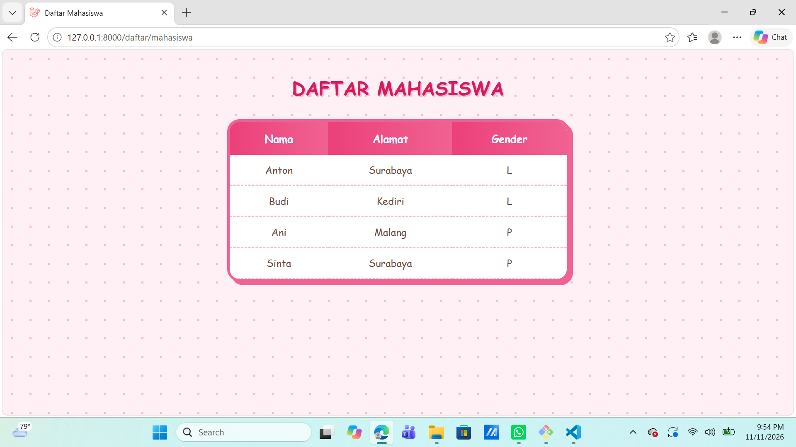
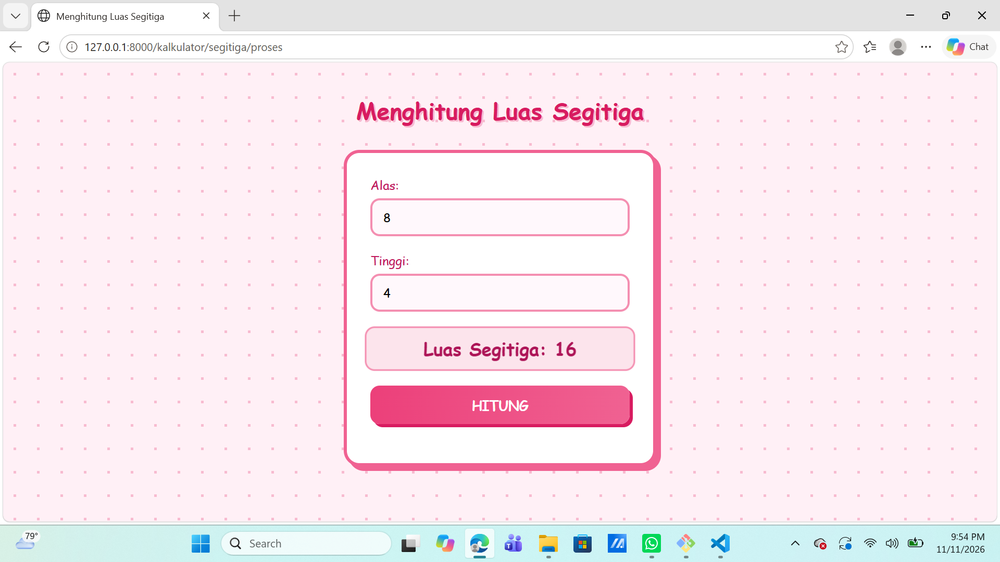

# Aplikasi Daftar Mahasiswa dan Kalkulator Luas Segitiga

### Tugas Pemrograman Web — Laravel

## Deskripsi

Proyek ini merupakan aplikasi web sederhana untuk tugas pemrograman web menggunakan Laravel. Aplikasi menyediakan halaman daftar mahasiswa dengan data contoh yang ditampilkan dalam tabel, serta kalkulator luas segitiga yang menghitung hasil dari alas dan tinggi yang dimasukkan pengguna. Halaman daftar mahasiswa dan kalkulator menggunakan CSS eksternal bertema pink lembut, dengan animasi saat elemen muncul dan efek interaksi saat elemen diarahkan (*hover*).

## Fitur

- **Daftar mahasiswa:** menampilkan data mahasiswa dalam tabel dengan kolom nama, alamat, dan gender.
- **Kalkulator segitiga:** menerima nilai alas dan tinggi, lalu menampilkan hasil perhitungan luas dengan rumus `½ × alas × tinggi`. Contoh: alas 10 dan tinggi 8 menghasilkan luas 40.
- Menggunakan tema warna pink lembut.
- Menampilkan animasi pada elemen dan efek interaksi saat elemen diarahkan (*hover*).

### Contoh Hasil Daftar Mahasiswa

Berikut contoh data yang ditampilkan pada halaman daftar mahasiswa:

| Nama | Alamat | Gender |
|---|---|---|
| Anton | Surabaya | L |
| Budi | Kediri | L |
| Ani | Malang | P |
| Sinta | Surabaya | P |

### Contoh Hasil Kalkulator Segitiga

Jika pengguna memasukkan alas `10` dan tinggi `8`, perhitungannya adalah:

```text
Luas = ½ × alas × tinggi
Luas = ½ × 10 × 8
Luas Segitiga: 40
```

## Teknologi dan Tools

- **Laravel 13** — framework untuk membangun aplikasi web.
- **PHP 8.3 atau lebih baru** — bahasa pemrograman yang digunakan oleh Laravel.
- **Blade** — template engine Laravel untuk menyusun tampilan halaman.
- **HTML** — struktur formulir, tabel, dan konten halaman.
- **CSS** — mengatur tema warna, animasi, dan efek interaksi.
- **Composer** — mengelola dependensi PHP proyek.

## Struktur Folder Utama

Berikut struktur file yang berkaitan langsung dengan tugas:

```text
web-app/
├── app/
│   └── Http/
│       └── Controllers/
│           ├── KalkulatorController.php
│           └── MahasiswaController.php
├── docs/
│   └── screenshots/
│       ├── daftar-mahasiswa.png
│       └── kalkulator-segitiga.png
├── public/
│   └── css/
│       └── style.css
├── resources/
│   └── views/
│       ├── daftar_mahasiswa.blade.php
│       └── segitiga.blade.php
├── routes/
│   └── web.php
├── ...
└── README.md
```

File dan folder bawaan Laravel lainnya tidak ditampilkan.

## Halaman dan Route

| Halaman | URL | Keterangan |
|---|---|---|
| Daftar mahasiswa | `/daftar/mahasiswa` | Menampilkan tabel data mahasiswa. |
| Kalkulator segitiga | `/kalkulator/segitiga` | Menampilkan formulir perhitungan luas segitiga. |

Form kalkulator mengirim data ke route `POST /kalkulator/segitiga/proses` untuk menghitung dan menampilkan hasil.

## Cara Menjalankan

Pastikan PHP 8.3 atau lebih baru dan Composer sudah terpasang. Buka Git Bash dari folder utama repository, lalu ikuti langkah berikut:

1. Masuk ke folder proyek:

```bash
cd web-app
```

2. Pasang dependensi:

```bash
composer install
```

3. Salin file konfigurasi `.env`:

```bash
cp .env.example .env
```

4. Buat kunci aplikasi:

```bash
php artisan key:generate
```

5. Jalankan server:

```bash
php artisan serve
```

Buka alamat `http://127.0.0.1:8000` di browser. Untuk halaman tugas, kunjungi `http://127.0.0.1:8000/daftar/mahasiswa` atau `http://127.0.0.1:8000/kalkulator/segitiga`.

## Dokumentasi Screenshot

### Daftar Mahasiswa



### Kalkulator Segitiga



## Identitas Mahasiswa

- **Nama Mahasiswa:** Khoirun Roifah
- **Tanggal Pembuatan:** 11 November 2026
